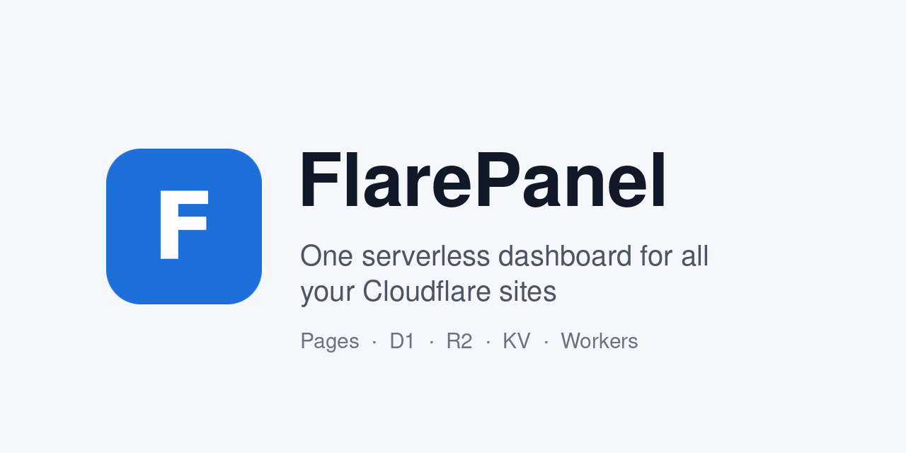
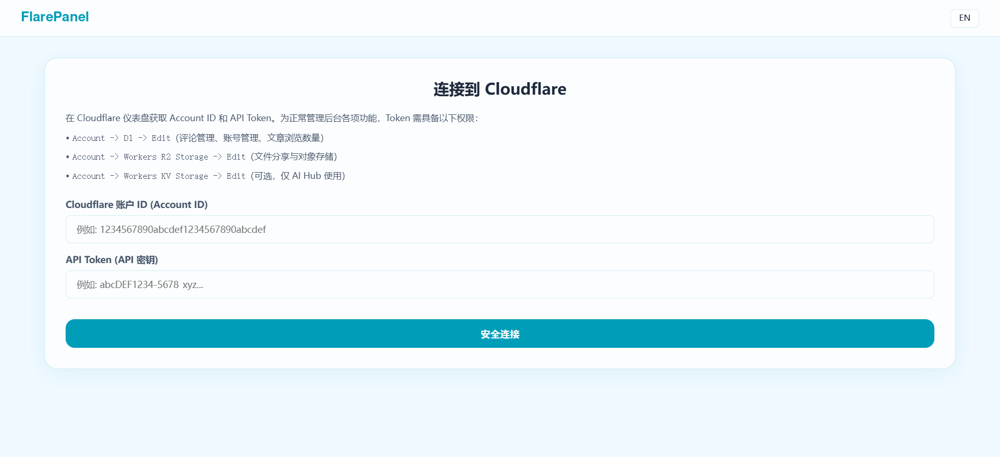
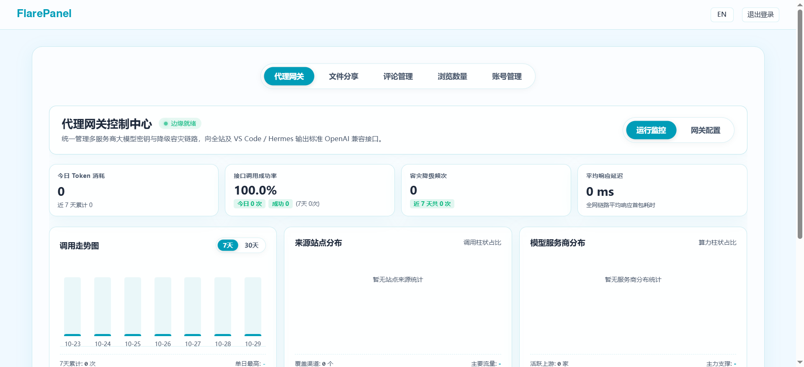

# FlarePanel



[简体中文](README.md) | **English**

One dashboard for all your Cloudflare-hosted sites: comments, page views, user accounts, R2 files, and an optional AI gateway config.

It runs entirely on Cloudflare Pages: no server and no build step. You sign in with your own Cloudflare API Token, and all data stays in your own account. The interface is available in Simplified Chinese, Traditional Chinese and English, switchable at the top right; dark mode follows your system by default and can also be toggled by hand.





## Features

| Section | Resource | What it does |
|---|---|---|
| Files | R2 bucket | Browse folders, upload (multipart for large files), create folders, rename, move, delete, copy links, and show download counts |
| Comments | D1 `comments` | Filter by page, search, reply as the site admin, delete one or many, export CSV |
| Page views | D1 `article_views` | Filter by category, sort by views or last update, delete, export CSV |
| Accounts | D1 `users` | Search, sort, delete members, export CSV |
| AI Gateway (optional) | KV | Manage the AI gateway's providers, models, failover chain and usage stats; needs a companion gateway Worker |

One panel can manage several sites; switch between them at the top. When no site has a given kind of resource configured, that section is hidden automatically.

## Interface language

- Simplified Chinese, Traditional Chinese and English are supported. The language menu on the right of the top bar switches language; the choice is saved in the browser and the page reloads.
- If you have never chosen, the browser language decides: Traditional Chinese for `zh-TW`, `zh-HK`, `zh-MO` and `zh-Hant`, Simplified Chinese for other `zh` languages, English otherwise.
- Dark mode follows your system automatically. The moon / sun button next to the language menu toggles it by hand; the next time your system switches between light and dark, the panel goes back to automatic.
- Dates and numbers are formatted for the active language.
- Content you write in `sites.config.js`, such as site names and the panel title, is your data and is shown as written, not translated.
- The dictionaries live in `assets/js/i18n/zh.js`, `zh-Hant.js` and `en.js`. All three must have the same keys; CI checks this (`scripts/check-i18n.mjs`). The Traditional Chinese dictionary is converted from Simplified with OpenCC (s2twp) and then corrected.

## Deployment

### 1. Fork or download this repository

### 2. Edit `sites.config.js`

This is the only file you need to change. Add one entry per site:

```js
export const SITES = [
    {
        name: 'My Blog',
        url: 'https://blog.example.com',
        commentDb: 'blog-comment',   // D1 database name
        accountDb: '',               // leave empty if the site has no member system
        bucket: 'blog-assets',       // R2 bucket name
        filesDomain: 'https://files.example.com',
        aiSiteId: ''
    }
];
```

The panel only lists the databases and buckets named here; other resources in your account never show up. See "Configuration" below for every field.

### 3. Create the tables

Use `schema.sql` to create the tables in the comment database (existing tables are skipped):

```bash
npx wrangler d1 execute blog-comment --remote --file=schema.sql
```

Your site or comment Worker writes comments, page views and download counts; FlarePanel manages them. See "Database schema" below.

### 4. Deploy to Cloudflare Pages

Cloudflare dashboard → Workers & Pages → Create → Pages → Connect to Git, and pick this repository:

- Framework preset: None
- Build command: leave empty
- Build output directory: `/`

Or from the command line:

```bash
npx wrangler pages deploy . --project-name flarepanel
```

### 5. Set environment variables

Pages project → Settings → Environment variables:

| Variable | Required | Description |
|---|---|---|
| `CF_ACCOUNT_ID` | Yes | Your 32-character Account ID. The server-side endpoints use it to confirm the caller is an admin of this account, and `/api/cf` and `/api/s3` only forward requests for this account. Without it every endpoint answers "server not configured" |
| `R2_ACCESS_KEY_ID` | No | R2 S3 API key; needed to upload files larger than 100 MB |
| `R2_SECRET_ACCESS_KEY` | No | Same as above |

Redeploy once after changing environment variables so they take effect.

### 6. Recommended: add access protection

The panel signs in with an API Token, but anyone can open the page itself. Add an email check for the panel's domain in Cloudflare Zero Trust → Access so only you can reach it.

## Configuration

`sites.config.js` has three parts:

**`PANEL`: the panel as a whole**

| Field | Description |
|---|---|
| `title` | Panel title, shown in the browser tab and the top bar |
| `adminName` | Nickname used when you reply to comments from the panel. Can be `{ zh: '站长', en: 'Admin' }` to follow the interface language |
| `viewTypes` | Page categories for page-view stats, matched by URL prefix, e.g. `{ key: 'posts', label: { zh: '文章', en: 'Posts' }, prefixes: ['/posts/'] }`. `label` can be plain text or a per-language object (you may add `'zh-Hant'`; Traditional Chinese falls back to `zh`). Unmatched pages go to "Other pages" |
| `viewExcludes` | Pages hidden from page-view stats: any URL containing one of these keywords is skipped |

**`SITES`: one entry per site**

| Field | Description |
|---|---|
| `name` | Site display name |
| `url` | Site URL; relative paths in comments and page views are linked against it |
| `commentDb` | D1 database name (not ID) of the comment database, holding `comments`, `article_views` and `file_downloads` |
| `accountDb` | D1 database name of the account database, holding `users`; leave empty without a member system |
| `bucket` | R2 bucket name; leave empty if you don't use file management |
| `filesDomain` | Public domain bound to the bucket, used to copy file links and read files quickly |
| `aiSiteId` | This site's `site_id` in the AI gateway logs; leave empty without AI Hub |
| `viewTypes` | Optional; overrides `PANEL.viewTypes` |

Leave unused resources as empty strings and the matching section hides that site.

**`AI_HUB`: AI gateway (optional)**

| Field | Description |
|---|---|
| `enabled` | Whether to show the "AI Gateway" section |
| `gatewayUrl` | Gateway URL, ending in `/v1` |
| `kvNamespaceId` | ID of the KV namespace the gateway reads its config from |
| `configKey` | Config key in KV, `AI_GATEWAY_CONFIG` by default |

## Database schema

`schema.sql` has the full statements with field comments. The panel only reads and writes the fields below; your site can add more fields without affecting it.

| Table | Database | Main fields | Notes |
|---|---|---|---|
| `comments` | comment DB | `id`, `nick`, `comment`, `url`, `parent_id`, `ip`, `likes`, `is_author`, `created_at` | Comments. `parent_id` is the id of the comment being replied to; `is_author = 1` marks replies posted by the admin from the panel; `created_at` is stored in UTC |
| `article_views` | comment DB | `id`, `url` (unique), `views`, `updated_at` | One row per page; your site adds 1 per visit |
| `file_downloads` | comment DB | `file_path` (primary key), `downloads` | R2 download counts; the panel keeps paths in sync when you rename or move files |
| `users` | account DB | `id`, `username` (unique), `password_hash`, `created_at`, `last_login_at` | Member accounts. The panel never reads `password_hash` |

## API Token for signing in

My Profile → API Tokens → Create Token → Custom token, with these account-level permissions:

| Permission | Used for |
|---|---|
| D1 → Edit | Comments, page views, accounts (also used to verify the token at sign-in) |
| Workers R2 Storage → Edit | Files |
| Workers KV Storage → Edit | Only needed when AI Hub is enabled |

The Account ID and token are stored only in your browser's localStorage. Requests go through this site's `/api/cf` to `api.cloudflare.com` (browsers can't call it cross-origin directly); the proxy neither logs nor stores them. The Account ID you enter at sign-in must match the `CF_ACCOUNT_ID` environment variable. On a shared computer, click "Sign out" when you are done.

## Security

Every `/api/*` endpoint requires the caller to be an admin of the `CF_ACCOUNT_ID` account: the caller's Cloudflare API Token is used to list this account's D1 databases or R2 buckets, and the request is allowed only if that works. A successful check is cached in memory for about 5 minutes, keyed by the token's SHA-256, so not every request costs an extra call to Cloudflare.

| Endpoint | Protection |
|---|---|
| `/api/cf/*` | Requires an admin token (`Authorization: Bearer`) and only forwards endpoints under `accounts/<CF_ACCOUNT_ID>/...`. Other account IDs get 403, paths outside the account (such as `user/...`) get 403, and paths that use `..` to leave the account are rejected |
| `/api/s3/*` | Only forwards to `<CF_ACCOUNT_ID>.r2.cloudflarestorage.com`. The account ID in the request header is only checked for a match (403 otherwise). `Authorization` carries the S3 signature, so the sign-in token is sent in a separate `x-cf-token` header and checked (R2 permission required); that header is never forwarded to R2. CORS preflight allows it |
| `/api/s3-credentials` | Only an admin token with R2 permission can read the S3 keys |
| `/api/fetch-models` | Admin token; only public https addresses are allowed |
| `/api/test-telegram` | Admin token. The frontend sends test messages only through this endpoint and no longer calls Telegram directly from the browser; the test message is generic text with no site names |

Also:

- Endpoint errors come back in Chinese or English based on the `Accept-Language` request header, together with a `code` field; the panel sends this header to match the interface language.
- The middleware blocks `.md`, `.sql`, dotfiles, `wrangler.*`, `scripts/`, `lib/` and similar, so they can't be downloaded as static files.
- CI runs a gitleaks secret scan on every commit.

Please report security issues privately through a GitHub Security Advisory rather than a public issue.

## AI Hub (optional)

AI Hub manages an OpenAI-compatible AI gateway Worker: providers and models are stored in KV, and the gateway reads them and forwards requests along the failover chain. The gateway Worker is not part of this repository; without one, keep `AI_HUB.enabled: false` and the section stays hidden. The gateway needs to provide:

| Endpoint | Purpose |
|---|---|
| `GET /v1/models` | Currently available models |
| `POST /v1/chat/completions` | Chat, with streaming |
| `GET /v1/stats?days=7` | Usage stats |
| `POST /v1/reload` | Called after the panel saves config so the gateway reloads it, with `Authorization: Bearer <Master Key>` |

"Send test notification" for Telegram alerts goes through this site's `/api/test-telegram` and requires being signed in to the panel.

## Local preview

```bash
cp .dev.vars.example .dev.vars   # fill in CF_ACCOUNT_ID
npx wrangler pages dev .
```

## Tech stack

Plain HTML / CSS / ES modules, with Cloudflare Pages Functions as the backend. No framework and no build: edit, refresh, done.

## Tutorials

The comments, page views, R2 files and AI gateway that FlarePanel manages are built step by step in the "Cloudflare 建站" series on Xiaobao Tech (in Chinese):

- [Domain + GitHub + Cloudflare Pages deployment](https://xbkjz.cn/posts/2026/02-10-cloudflare-pages-deployment/)
- [Pages pitfalls: from 522 errors to clean redirects](https://xbkjz.cn/posts/2026/02-10-cloudflare-pages-troubleshooting/)
- [Building site infrastructure on the Cloudflare stack](https://xbkjz.cn/posts/2026/03-07-cloudflare-comment-system/)
- [Free comment system with D1 + Workers](https://xbkjz.cn/posts/2026/03-08-cloudflare-d1-comment-system/)
- [Comment filtering and caching with Workers](https://xbkjz.cn/posts/2026/03-10-cloudflare-workers-security-cache/)
- [Cloudflare Drop: one-click static hosting](https://xbkjz.cn/posts/2026/07-09-cloudflare-drop/)
- [Rate limiting with Workers + KV](https://xbkjz.cn/posts/2026/07-09-cloudflare-workers-rate-limiting/)
- [Free file sharing on R2](https://xbkjz.cn/posts/2026/08-28-cloudflare-r2-file-sharing/)
- [A unified AI gateway on Workers](https://xbkjz.cn/posts/2026/10-06-cloudflare-workers-ai-gateway/)
- [Dashboard settings guide: SSL, security, speed](https://xbkjz.cn/posts/2026/10-12-cloudflare-settings-guide/)
- [Cloudflare settings cheat sheet](https://xbkjz.cn/wiki/cloudflare-settings/)

## License

[MIT](LICENSE) © 2026 Cheng Xiaobao (程小宝)
